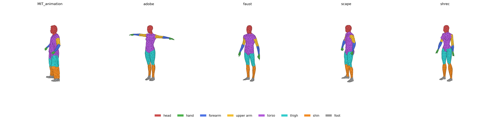
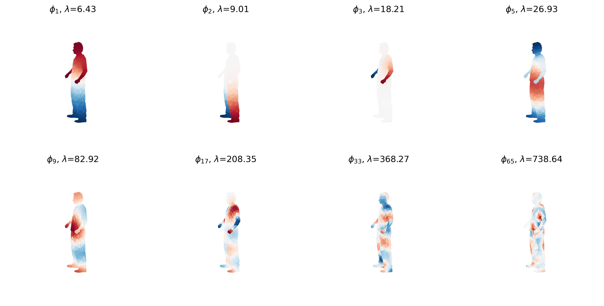
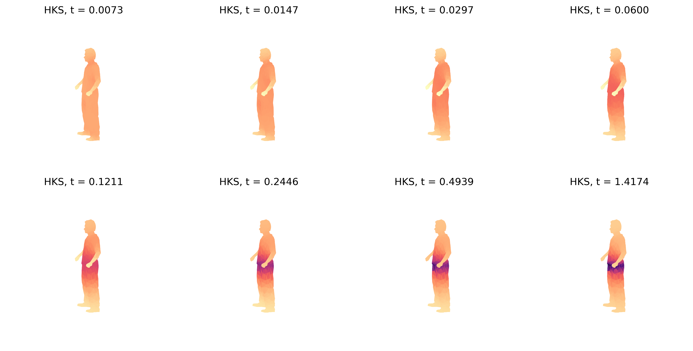
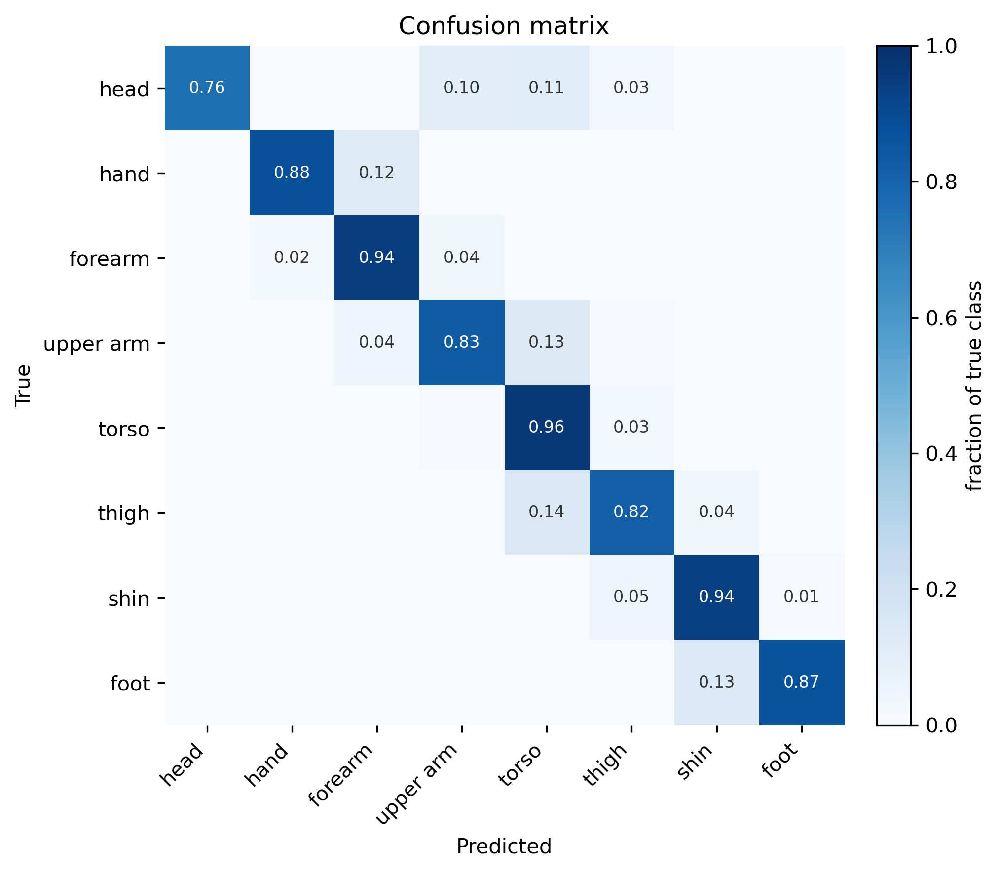
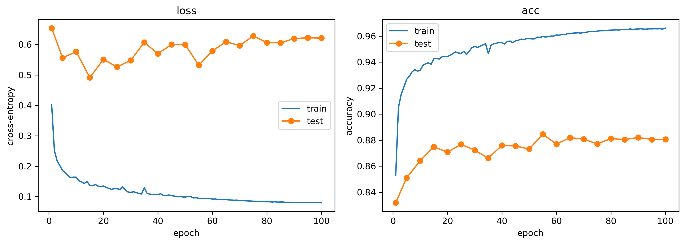

# 3D Human Mesh Part Segmentation with Spectral Features and DiffusionNet

Semantic segmentation of human body meshes into 8 parts (head, hand, forearm, upper arm, torso, thigh, shin, foot).
The network only sees **intrinsic** geometry (Laplace–Beltrami eigenbasis and Heat Kernel Signature), so its
predictions do not depend on how the mesh is oriented.

**Test results (SHREC'07, unseen during training): 88.1% face accuracy, 79.9% mIoU**, with a 200k-parameter model
that trains in about 2 minutes on a single GPU.



## Dataset

The preprocessed human segmentation benchmark from [MeshCNN](https://github.com/ranahanocka/MeshCNN)
([download](https://www.dropbox.com/scl/fi/r04ahap6vhuwzkjj9mpwk/human_seg.tar.gz?rlkey=dyjwx6ehxmarvtrzl6atvs9mz&e=1)),
extracted to `human_seg/`.

| Split | Source | Meshes |
|-------|--------|-------:|
| train | MIT animation (Vlasic et al., 2008) | 169 |
| train | FAUST (Bogo et al., 2014) | 100 |
| train | SCAPE (Anguelov et al., 2005) | 71 |
| train | Adobe Fuse | 41 |
| test  | SHREC'07 (Giorgi et al., 2007) | 18 |

## Method

### Normalization

Each mesh is centered at its area-weighted centroid and scaled to **unit surface area** ($`V \leftarrow V / \sqrt{A}`$).
This makes eigenvalues comparable across meshes, so the same diffusion times can be used for all of them.

For the figures, meshes are additionally rotated upright using the ground-truth part centers. This rotation has no
effect on the model's input, because every feature below is intrinsic.

### Laplace–Beltrami operator

On a flat grid the Laplacian $\Delta f$ measures how much a value differs from the average of its neighbors.
The **Laplace–Beltrami operator** is the same idea on a curved surface. On a triangle mesh it is discretized as the
**cotangent Laplacian**:

```math
(L f)_i = \sum_{j \in N(i)} w_{ij}\,(f_i - f_j), \qquad w_{ij} = \tfrac12(\cot\alpha_{ij} + \cot\beta_{ij})
```

where $\alpha_{ij}, \beta_{ij}$ are the two angles opposite the edge $(i,j)$. Each vertex also gets a **mass**
$M_i$ equal to one third of the area of its adjacent triangles (lumped mass matrix).

Only angles and areas appear, so $L$ is invariant to rotation and translation, and it barely changes when the body
bends, because bending hardly stretches the surface.

$L$ and $M$ are built with [`robust_laplacian`](https://github.com/nmwsharp/robust-laplacians-py), which implements
this discretization and stays well-behaved on degenerate triangles.

### Eigenfunctions

Solving the generalized eigenproblem

```math
L\,\phi_k = \lambda_k\, M\,\phi_k, \qquad 0 = \lambda_0 \le \lambda_1 \le \dots
```

gives the mesh's spectral basis, a Fourier basis for the surface: low eigenvalues describe large-scale patterns,
high eigenvalues capture finer detail.

The first **128** eigenpairs are computed with `scipy.sparse.linalg.eigsh` in shift-invert mode, and the constant
eigenfunction $\phi_0$ is discarded.



### Heat Kernel Signature

Imagine placing a unit of heat at point $x$ and letting it spread over the surface for time $t$.
**How much heat is still at $x$** depends on the geometry around $x$:

* at the tip of a hand or foot heat can only flow one way → it stays → **high** value;
* in the middle of the torso heat escapes in all directions → **low** value.

Small $t$ describes local shape; large $t$ describes the position within the whole body (tip of a limb vs. center).
Using the eigenbasis this has a closed form:

```math
\mathrm{HKS}(x, t) = \sum_k e^{-\lambda_k t}\, \phi_k(x)^2
```

Because only $\phi_k^2$ appears, the arbitrary sign of each eigenfunction doesn't matter.

The signature is evaluated at **16 logarithmically spaced times**. The range is derived from the training spectrum,
$`t \in [\,4\ln 10/\lambda_{K},\; 4\ln 10/\lambda_1\,]`$ with median eigenvalues over the training meshes, which gives
$`t \approx 0.0073 \dots 1.42`$. Because every mesh has unit area, the same times are used for all meshes, so channel
$j$ means the same thing on every body. Each time slice is normalized by the heat trace and log-transformed, so all
channels live on a similar numeric scale:

```math
\widetilde{\mathrm{HKS}}(x,t) = \log \frac{\mathrm{HKS}(x,t)}{\sum_k e^{-\lambda_k t}}
```

Finally each channel is standardized with the mean and standard deviation of the training set. The result is a
**16-dimensional descriptor per vertex** that is rotation-invariant and almost pose-invariant.



### MiniDiffusionNet

[DiffusionNet](https://github.com/nmwsharp/diffusion-net) (Sharp et al., 2022) turns heat diffusion into a learnable
layer: HKS uses **fixed** times, DiffusionNet diffuses learned features with **learned** times. This project uses a
compact version of it:

Each **DiffusionBlock**:

1. **diffuses** every channel $u$ over the surface for its own learned time $t_c$, computed in the eigenbasis:
   $`u \mapsto \Phi\, \mathrm{diag}(e^{-\lambda t_c})\, \Phi^{\top} M\, u`$
   (small $t_c$ = local context, large $t_c$ = whole-body context);
2. concatenates the input and diffused features and mixes them with a per-vertex **MLP**
   (256 → 128 → 128, ReLU, dropout 0.3);
3. adds the result back to the input (**residual** connection).

Unlike the full DiffusionNet, there are no spatial-gradient features; the model only has isotropic diffusion.

**Training:** cross-entropy on face labels, AdamW (lr 1e-3, weight decay 1e-4), cosine schedule over 100 epochs,
one mesh per step, Gaussian noise (σ = 0.05) on the standardized HKS as augmentation.

## Results

Evaluated on the 18 SHREC'07 test meshes after 100 epochs.

| | |
|---|---:|
| Face accuracy | **88.1%** |
| Mean IoU (area-weighted) | **79.9%** |

| Class | head | hand | forearm | upper arm | torso | thigh | shin | foot |
|---|---:|---:|---:|---:|---:|---:|---:|---:|
| IoU | 0.758 | 0.847 | 0.840 | 0.696 | 0.823 | 0.757 | 0.825 | 0.848 |



*Row-normalized, area-weighted confusion matrix. Almost all errors are between parts that touch:
thigh → torso (hip), upper arm → torso (shoulder), foot → shin (ankle), hand → forearm (wrist), head → torso (neck).*



*Training and test loss/accuracy. Test accuracy plateaus around 88% after ~15 epochs while training accuracy keeps
rising to 96.6%, so the model overfits slightly.*

## Getting started

```bash
pip install torch scipy matplotlib robust_laplacian
pip install "git+https://github.com/facebookresearch/pytorch3d.git"
```

Download the dataset and extract it to `human_seg/`, then:

```bash
python python_scripts/train.py     # preprocess, train for 100 epochs, save model.pt (~2 min on a GPU)
```

`model.pt` stores the weights together with the HKS times and normalization statistics, which `predict.py` and
`annotate.py` need to process new meshes.

```
├── python_scripts/
│   ├── data.py        # paths, mesh loading, edge → face labels, alignment
│   ├── features.py    # Laplace–Beltrami eigenbasis, HKS, normalization
│   ├── model.py       # MiniDiffusionNet
│   ├── train.py       # training loop; run to train and save model.pt
│   ├── evaluate.py    # predictions, confusion matrix, IoU
│   ├── plotting.py    # all figures
│   ├── predict.py     # segment any .obj with the trained model
│   └── annotate.py    # write .eseg / .seseg annotation files from predictions
├── notebooks/
│   └── main.ipynb     # exploration notebook: data, spectra, HKS, training, analysis
├── annotations/       # generated annotation files for new meshes
├── assets/            # figures used in this README
├── human_seg/         # dataset (train/, test/, seg/, sseg/), not tracked by git
└── model.pt           # trained model
```

## References

- N. Sharp, S. Attaiki, K. Crane, M. Ovsjanikov. *DiffusionNet: Discretization Agnostic Learning on Surfaces.* ACM TOG 2022. [code](https://github.com/nmwsharp/diffusion-net)
- J. Sun, M. Ovsjanikov, L. Guibas. *A Concise and Provably Informative Multi-Scale Signature Based on Heat Diffusion.* SGP 2009.
- N. Sharp, K. Crane. *A Laplacian for Nonmanifold Triangle Meshes.* SGP 2020. [code](https://github.com/nmwsharp/robust-laplacians-py)
- R. Hanocka et al. *MeshCNN: A Network with an Edge.* SIGGRAPH 2019. [code](https://github.com/ranahanocka/MeshCNN)
- H. Maron et al. *Convolutional Neural Networks on Surfaces via Seamless Toric Covers.* SIGGRAPH 2017.
- N. Ravi et al. *Accelerating 3D Deep Learning with PyTorch3D.* 2020. [code](https://github.com/facebookresearch/pytorch3d)
- Datasets: SCAPE (Anguelov et al., 2005), MIT animation (Vlasic et al., 2008), FAUST (Bogo et al., 2014), SHREC'07 (Giorgi et al., 2007).
