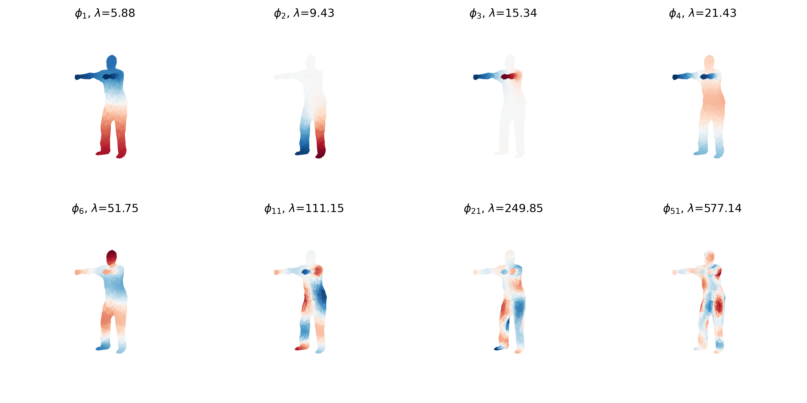

# 3D Human Mesh Part Segmentation using DiffusionNet

## Overview

A deep learning pipeline for semantic 3D human mesh segmentation (8 classes) that leverages intrinsic geometric features (Laplace–Beltrami and HKS) to achieve spatial invariance, ensuring robust generalization across diverse poses and datasets.

## Dataset

The preprocessed human segmentation benchmark from [MeshCNN](https://github.com/ranahanocka/MeshCNN) ([download](https://www.dropbox.com/scl/fi/r04ahap6vhuwzkjj9mpwk/human_seg.tar.gz?rlkey=dyjwx6ehxmarvtrzl6atvs9mz&e=1)), extracted to `human_seg/`.

| Split | Source | Meshes |
|-------|--------|-------:|
| train | MIT animation (Vlasic et al., 2008) | 169 |
| train | FAUST (Bogo et al., 2014) | 100 |
| train | SCAPE (Anguelov et al., 2005) | 71 |
| train | Adobe Fuse | 41 |
| test  | SHREC'07 (Giorgi et al., 2007) | 18 |

## Methodology

### Normalization

Each mesh is centered at its area-weighted centroid and scaled to **unit surface area**, $V \leftarrow V / \sqrt{A}$.
This makes the eigenvalues of different meshes comparable, so one set of diffusion times works for all of them.

### Laplace–Beltrami operator

On a flat grid the Laplacian $\Delta f$ measures how much a value differs from the average of its neighbors.
The **Laplace–Beltrami operator** is the same idea on a curved surface. On a triangle mesh it is discretized as the
**cotangent Laplacian**:

$$ (L f)_i = \sum_{j \in N(i)} w_{ij}\ (f_i - f_j), \qquad w_{ij} = \tfrac12(\cot\alpha_{ij} + \cot\beta_{ij}) $$

where $\alpha_{ij}, \beta_{ij}$ are the two angles opposite the edge $(i,j)$. Each vertex also gets a **mass**
$M_i$ = one third of the area of its adjacent triangles (the "lumped mass matrix").

Only angles and areas appear, and those don't change under rotation, so $L$ is rotation-invariant;
it also changes very little when the body bends, because bending barely stretches the surface.

We build $L$ and $M$ with [`robust_laplacian`](https://github.com/nmwsharp/robust-laplacians-py), which implements
exactly this discretization and also stays well-behaved on degenerate triangles.

### Eigenfunctions

Solving the generalized eigenproblem

$$ L\,\phi_k = \lambda_k\ M\ \phi_k \qquad 0 = \lambda_0 \le \lambda_1 \le \dots $$

gives functions $\phi_k$ on the surface that are the mesh's "vibration modes" (a Fourier basis for the surface):
small $\lambda$ = smooth, large-scale patterns; large $\lambda$ = fine detail.

We compute the first **128** eigenpairs with `scipy.sparse.linalg.eigsh` in shift-invert mode (`sigma` slightly below 0),
which returns the smallest eigenvalues and $M$-orthonormal eigenfunctions. The constant mode $\phi_0$ ($\lambda_0 = 0$)
carries no information and is dropped.

*Eigenfunctions on one mesh (red = positive, blue = negative). $$\phi_1$$ runs from head to feet, $$\phi_2$$ separates the legs,
$$\phi_3$$ isolates an arm; higher modes oscillate faster and capture finer detail.*

### Heat Kernel Signature

Imagine placing a unit of heat at point $x$ and letting it spread over the surface for time $t$.
**How much heat is still at $x$** depends on the geometry around $x$:

* at the tip of a hand or foot heat can only flow one way → it stays → **high** value;
* in the middle of the torso heat escapes in all directions → **low** value.

Small $t$ describes local shape; large $$t$$ describes the position within the whole body (tip of a limb vs. center).
Using the eigenbasis this has a closed form:

$$ \mathrm{HKS}(x, t) = \sum_k e^{-\lambda_k t}\ \phi_k(x)^2 $$

Because only $\phi_k^2$ appears, the arbitrary sign of each eigenfunction doesn't matter.

We evaluate it at **16 logarithmically spaced times** $t \in [0.01,\, 1]$. Since every mesh has unit area, the same times
are used for all meshes, so channel $j$ means the same thing on every body. Each time slice is normalized by the heat trace
$\sum_k e^{-\lambda_k t}$ (the "scaled HKS") and log-transformed, so all 16 channels live on a similar numeric scale:

$$ \widetilde{\mathrm{HKS}}(x,t) = \log \frac{\mathrm{HKS}(x,t)}{\sum_k e^{-\lambda_k t}} $$

The result is a **16-dimensional descriptor per vertex** that is rotation-invariant and almost pose-invariant.
This is the input of our network.

*HKS at 8 of the 16 time scales (bright = more heat retained). At small $t$ the hands, feet and head already stand out;
as $t$ grows the signature encodes the distance from the body's center, with the darkest values at the waist.*

### DiffusionNet

DiffusionNet (Sharp et al., 2022) turns heat diffusion into a learnable layer. HKS uses **fixed** times; DiffusionNet
diffuses learned features with **learned** times. The network is a stack of blocks, each of which:

1. **diffuses** every feature channel $u$ over the surface for its own learned time $t$, computed cheaply in the
   eigenbasis: $\; u \mapsto \Phi\, \mathrm{diag}(e^{-\lambda t})\, \Phi^{\top} M\, u$
   (small $t$ = local context, large $t$ = whole-body context);
2. computes **spatial gradient features**: inner products of surface gradients, which add a sense of direction
   (along a limb vs. across it) while staying rotation-invariant;
3. mixes the input, diffused and gradient features with a per-vertex **MLP** and a residual connection.

The network takes the per-vertex HKS as input and outputs 8 class scores per vertex. These are averaged over the three
vertices of each triangle to give one prediction per face, trained with cross-entropy against the face labels.

## References

- N. Sharp, S. Attaiki, K. Crane, M. Ovsjanikov. *DiffusionNet: Discretization Agnostic Learning on Surfaces.* ACM TOG 2022. [code](https://github.com/nmwsharp/diffusion-net)
- J. Sun, M. Ovsjanikov, L. Guibas. *A Concise and Provably Informative Multi-Scale Signature Based on Heat Diffusion.* SGP 2009.
- N. Sharp, K. Crane. *A Laplacian for Nonmanifold Triangle Meshes.* SGP 2020. [code](https://github.com/nmwsharp/robust-laplacians-py)
- R. Hanocka et al. *MeshCNN: A Network with an Edge.* SIGGRAPH 2019. [code](https://github.com/ranahanocka/MeshCNN)
- H. Maron et al. *Convolutional Neural Networks on Surfaces via Seamless Toric Covers.* SIGGRAPH 2017.
- N. Ravi et al. *Accelerating 3D Deep Learning with PyTorch3D.* 2020. [code](https://github.com/facebookresearch/pytorch3d)
- Datasets: SCAPE (Anguelov et al., 2005), MIT animation (Vlasic et al., 2008), FAUST (Bogo et al., 2014), SHREC'07 (Giorgi et al., 2007).
