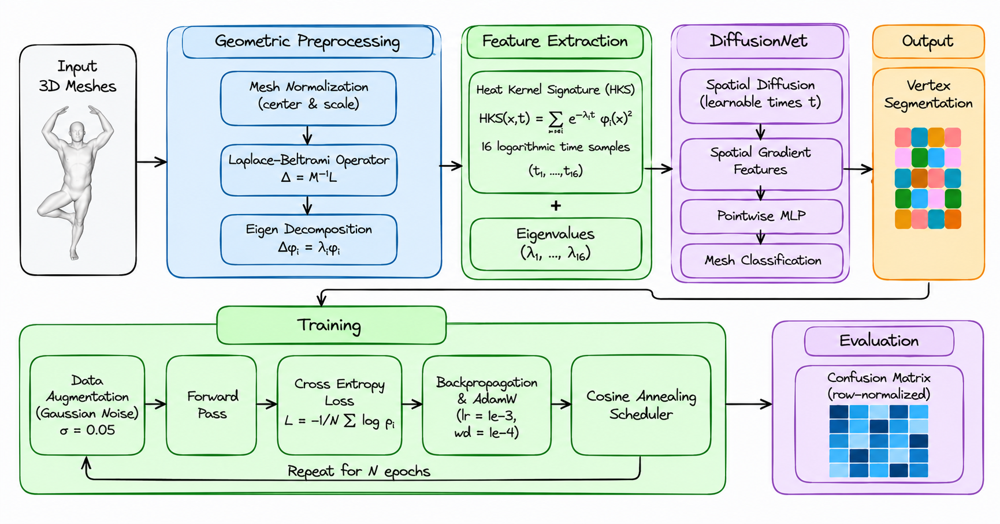
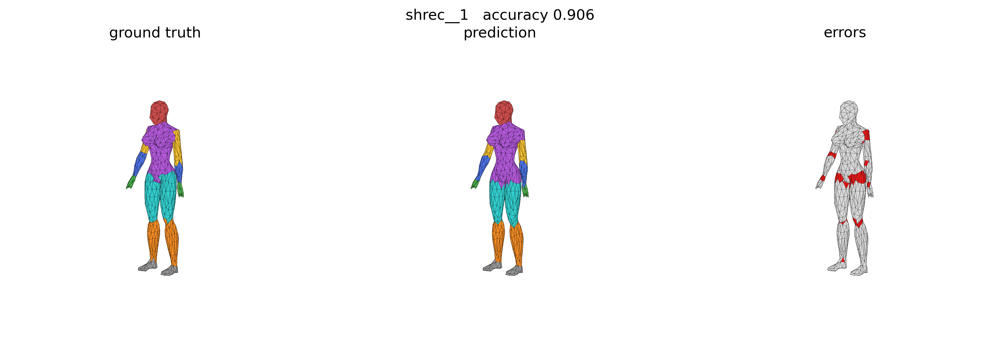
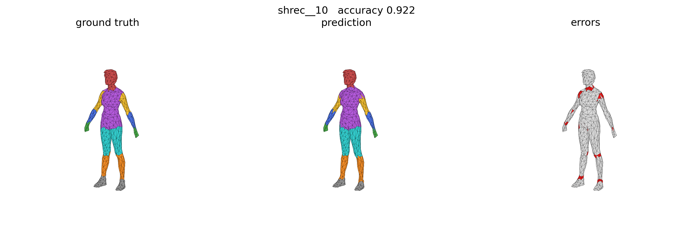
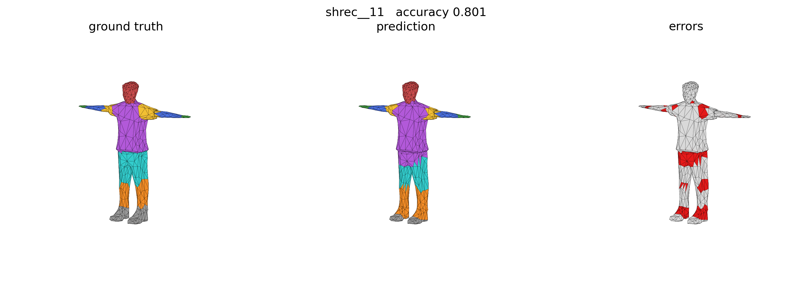

# Human Body Mesh Segmentation using DiffusionNet

A geometric deep leatning model for segmentimg 3D human body meshes into 8 semantic parts, achieving 88.1% accuracy on the SCHREC'07 benchmark.

<p align="center">
  
</p>

## Repository Structure

```
HumanBodySegmentation/
├── python_scripts/
│   ├── data.py        # Mesh loading, normalization, edge-to-face labels, alignment
│   ├── features.py    # Laplace–Beltrami spectrum and Heat Kernel Signature
│   ├── model.py       # MiniDiffusionNet architecture
│   ├── train.py       # Training loop and checkpointing (entry point)
│   ├── evaluate.py    # Inference, confusion matrix, IoU
│   └── plotting.py    # Visualization utilities
├── notebooks/
│   └── main.ipynb     # End-to-end walkthrough: data, features, training, evaluation
├── assets/            # Figures used in this README
├── human_seg/         # Dataset (download separately, see below)
└── model.pt           # Trained checkpoint
```

## Dataset

This project uses the preprocessed human segmentation benchmark from [MeshCNN](https://github.com/ranahanocka/MeshCNN)
([download](https://www.dropbox.com/scl/fi/r04ahap6vhuwzkjj9mpwk/human_seg.tar.gz?rlkey=dyjwx6ehxmarvtrzl6atvs9mz&e=1)). Extract it into the repository root:

```bash
tar -xzf human_seg.tar.gz 
```
## Methodology



## Results

<p align="center">
  
  
  
</p>

### Predictions

<p align="center">
  
</p>

<details>
<summary><b>More examples</b></summary>
<br>
<p align="center">
  
  
</p>
</details>

### Per-class IoU

<div align="center">

|  |  |  |  |  |  |  |  | **Mean** |
|:---:|:---:|:---:|:---:|:---:|:---:|:---:|:---:|:---:|
| 75.8 | 84.7 | 84.0 | 69.6 | 82.3 | 75.7 | 82.5 | 84.8 | **79.9** |

</div>

### Training curves

<p align="center">
  
</p>

Test accuracy levels off at about 88% after roughly 15 epochs, while training accuracy keeps climbing to 96.6%. This points to mild overfitting.

### Error analysis

<table>
  <tr>
    <td width="50%" align="center">
      
    </td>
    <td width="50%">
      <p>The confusion matrix is <b>row-normalized and area-weighted</b>. Almost all errors fall at boundaries between parts that touch:</p>
      <table>
        <tr><th>True → Predicted</th>
        <tr><td>thigh → torso</td>
        <tr><td>upper arm → torso</td>
        <tr><td>foot → shin</td>
        <tr><td>hand → forearm</td>
        <tr><td>head → torso</td>
      </table>
  </tr>
</table>

## References

- N. Sharp, S. Attaiki, K. Crane, M. Ovsjanikov. *DiffusionNet: Discretization Agnostic Learning on Surfaces.* ACM TOG, 2022. [[code]](https://github.com/nmwsharp/diffusion-net)
- J. Sun, M. Ovsjanikov, L. Guibas. *A Concise and Provably Informative Multi-Scale Signature Based on Heat Diffusion.* SGP, 2009.
- N. Sharp, K. Crane. *A Laplacian for Nonmanifold Triangle Meshes.* SGP, 2020. [[code]](https://github.com/nmwsharp/robust-laplacians-py)
- R. Hanocka et al. *MeshCNN: A Network with an Edge.* SIGGRAPH, 2019. [[code]](https://github.com/ranahanocka/MeshCNN)
- H. Maron et al. *Convolutional Neural Networks on Surfaces via Seamless Toric Covers.* SIGGRAPH, 2017.
- N. Ravi et al. *Accelerating 3D Deep Learning with PyTorch3D.* arXiv, 2020. [[code]](https://github.com/facebookresearch/pytorch3d)
- Datasets: SCAPE (Anguelov et al., 2005), MIT animation (Vlasic et al., 2008), FAUST (Bogo et al., 2014), SHREC'07 (Giorgi et al., 2007).
